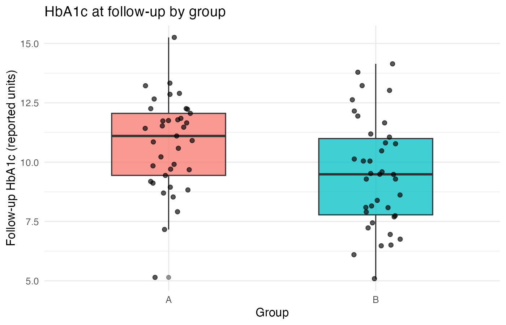
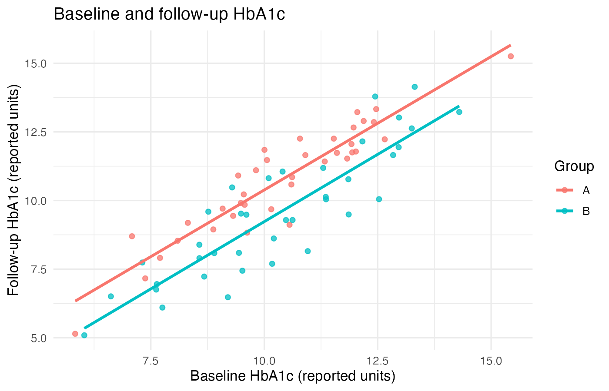
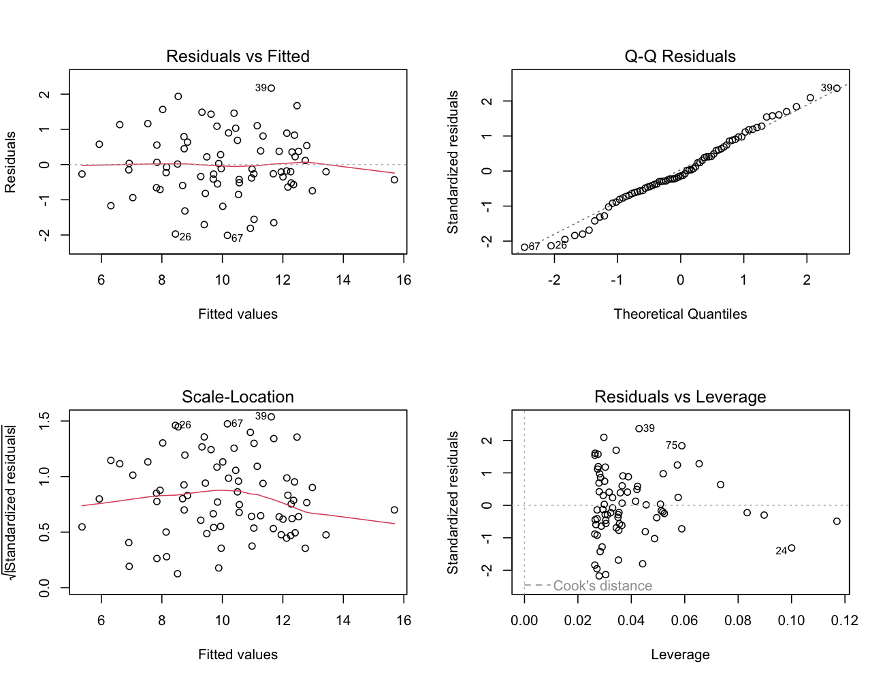

# Résumé

**Contexte.** L’ajustement sur la valeur initiale est utile pour comparer une variable de santé continue entre deux groupes évalués avant et après une intervention.

**Objectif.** Estimer la différence d’HbA1c au suivi entre les groupes A et B, après ajustement sur l’HbA1c initiale.

**Méthodes.** Un jeu de données pédagogique comprenant deux groupes a été analysé par analyse de covariance (ANCOVA), avec examen des résidus, vérification de l’hypothèse de pentes communes, utilisation d’erreurs standards robustes HC3 à l’hétéroscédasticité et analyses exploratoires des variations individuelles.

**Provenance des données.** Il s’agit d’une réanalyse indépendante d’un jeu de données fourni dans le cadre d’un enseignement universitaire. Le fichier ne contient ni protocole d’étude, ni description des traitements, ni unités de mesure documentées, ni éléments permettant de vérifier indépendamment une éventuelle répartition aléatoire. Ces résultats ne doivent **pas** être considérés comme des preuves issues d’un essai clinique ni être généralisés à des patients extérieurs à ce jeu de données.

# Données et reproductibilité

Le fichier fourni `data/hb.csv` utilise le point-virgule comme séparateur de champs **et la virgule comme séparateur décimal**. Une importation numérique correcte est indispensable : une première version du travail universitaire interprétait incorrectement les virgules décimales et produisait donc des résultats numériques erronés. Le présent rapport recalcule l’ensemble des statistiques à partir du fichier correctement importé.

```{r}
source("R/analysis.R", local = TRUE)
```

Le jeu de données comprend `r nrow(hb)` observations, `r length(unique(hb$id))` identifiants uniques et aucune valeur manquante. Le groupe A comprend `r sum(hb$groupe == "A")` observations et le groupe B `r sum(hb$groupe == "B")` observations. L’exercice pédagogique décrit l’HbA1c à l’inclusion (`hb0`) et lors d’un suivi réalisé environ trois mois plus tard (`hb1`). Le fichier CSV ne documente pas de manière indépendante les unités de mesure ; toutes les valeurs sont donc exprimées dans les **unités rapportées dans les données**.

# Méthodes statistiques

Le modèle d’analyse principal, défini pour cet exercice de portfolio, est le suivant :

$$
\mathrm{HbA1c}_{1,i} =
\beta_0 +
\beta_1 I(G_i = B) +
\beta_2 \mathrm{HbA1c}_{0,i} +
\varepsilon_i
$$

Le coefficient $\beta_1$ estime la différence moyenne entre le groupe B et le groupe A, ajustée sur l’HbA1c initiale. Nous présentons les intervalles de confiance à 95 % et les valeurs p bilatérales. Les graphiques des résidus et le test de Shapiro–Wilk permettent d’examiner leur distribution ; le test de Fligner–Killeen constitue une vérification exploratoire de la dispersion des résidus entre les groupes. Une interaction entre le groupe et la valeur initiale est ajustée afin d’évaluer l’hypothèse de pentes communes. Les erreurs standards robustes HC3 sont utilisées dans une analyse de sensibilité. Les tests non ajustés portant sur les variations individuelles (test de Welch et test des rangs de Wilcoxon) sont exploratoires et ne remplacent pas le paramètre estimé par l’ANCOVA.

# Résultats

## Statistiques descriptives

```{r}
knitr::kable(descriptives, digits = 2,
             caption = "HbA1c initiale, au suivi et variation individuelle par groupe")
```

```{r}

```

```{r}

```

## ANCOVA principale

```{r}
knitr::kable(coefficient_table, digits = 4,
             caption = "Coefficients de l’ANCOVA par moindres carrés ordinaires et intervalles de confiance à 95 %")
```

Le coefficient ajusté comparant le groupe B au groupe A est de **`r sprintf("%.2f", coef(ancova)["groupeB"])`** unité(s) rapportée(s) (IC à 95 % : **[`r sprintf("%.2f", ancova_ci["groupeB",1])` ; `r sprintf("%.2f", ancova_ci["groupeB",2])`]**, p = **`r format.pval(coef_matrix["groupeB", "Pr(>|t|)"], digits = 3, eps = 0.001)`**). Le coefficient de détermination R² du modèle ajusté est de `r sprintf("%.3f", ancova_summary$r.squared)`.

Un coefficient négatif indique que l’HbA1c moyenne au suivi est plus faible dans le groupe B **après ajustement statistique** sur l’HbA1c initiale. Ce résultat ne constitue pas, à lui seul, une preuve d’un effet causal du traitement.

## Diagnostics et analyses de sensibilité

```{r}

```

```{r}
knitr::kable(checks, caption = "Contrôles de qualité des données et diagnostics du modèle")
```

```{r}
knitr::kable(hc3_table, digits = 4,
             caption = "Analyse de sensibilité ANCOVA avec erreurs standards robustes HC3 à l’hétéroscédasticité")
```

Le test de l’interaction entre le groupe et la valeur initiale donne p = `r sprintf("%.3f", interaction_p)`. Le test de Shapiro–Wilk appliqué aux résidus donne p = `r sprintf("%.3f", normality_residuals$p.value)`. Ces résultats doivent être examinés conjointement aux graphiques et non interprétés comme des critères automatiques d’acceptation ou de rejet des hypothèses du modèle. L’intervalle de confiance HC3 fournit une vérification supplémentaire lorsque la variance résiduelle peut être inégale.

Les tests exploratoires des variations individuelles donnent p = `r format.pval(welch_change$p.value, digits=3, eps=0.001)` (Welch) et p = `r format.pval(wilcoxon_change$p.value, digits=3, eps=0.001)` (test des rangs de Wilcoxon). Ces tests portent sur les différences non ajustées de variation entre les groupes ; ils ne doivent pas être considérés comme équivalents au modèle ajusté sur la valeur initiale.

# Discussion

La prise en compte correcte des virgules décimales modifie substantiellement la relation estimée entre l’appartenance au groupe et l’HbA1c au suivi, par rapport à la première version du travail universitaire. La réanalyse met en évidence une association négative, après ajustement sur la valeur initiale, pour le groupe B comparativement au groupe A. L’ANCOVA convient à la comparaison définie, sous réserve que les hypothèses du modèle linéaire et les caractéristiques du plan d’étude soient suffisamment étayées.

## Limites

- Il s’agit d’un **jeu de données d’enseignement universitaire** de 75 observations, et non d’un jeu de données clinique validé.
- Le fichier CSV brut ne décrit ni les traitements, ni les caractéristiques des participants, ni les modalités d’allocation, ni l’exhaustivité du suivi, ni la documentation des sources.
- L’énoncé de l’exercice évoque une comparaison randomisée en groupes parallèles, mais la randomisation n’est pas vérifiable indépendamment à partir des données.
- Les unités de mesure de l’HbA1c ne sont pas documentées séparément dans le fichier fourni ; les différences numériques sont exprimées dans les unités originales des données.
- Les différences observées entre les groupes ne peuvent pas être considérées comme causales sans information fiable sur le plan d’étude et les modalités d’allocation.
- Un intervalle de confiance fondé sur un modèle quantifie l’incertitude sous certaines hypothèses statistiques ; il ne compense ni une provenance des données insuffisamment documentée ni un éventuel facteur de confusion non mesuré.

# Conclusion

Ce projet illustre une importation reproductible des données, l’ajustement d’un modèle linéaire sur la valeur initiale, l’estimation d’intervalles de confiance, les diagnostics du modèle, une analyse de sensibilité avec erreurs standards robustes et l’interprétation scientifique sous R et Quarto. Le principal enseignement méthodologique est que **les conventions d’importation doivent être vérifiées avant toute modélisation statistique**.

# Informations de reproductibilité

```{r}
print(sessionInfo())
```
