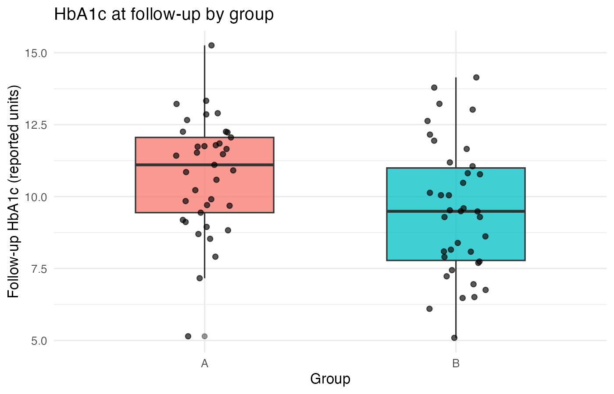
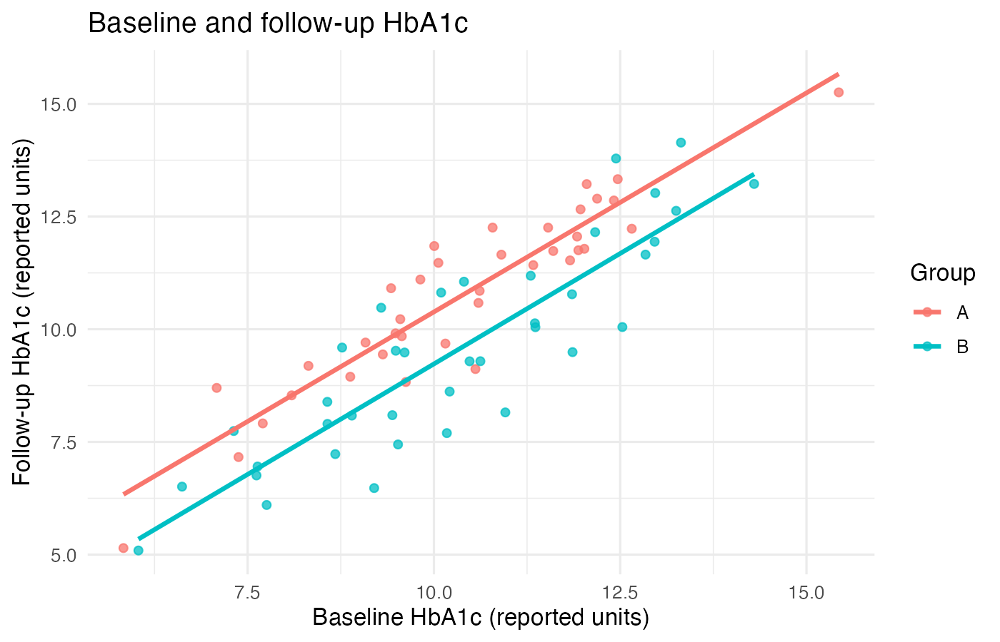
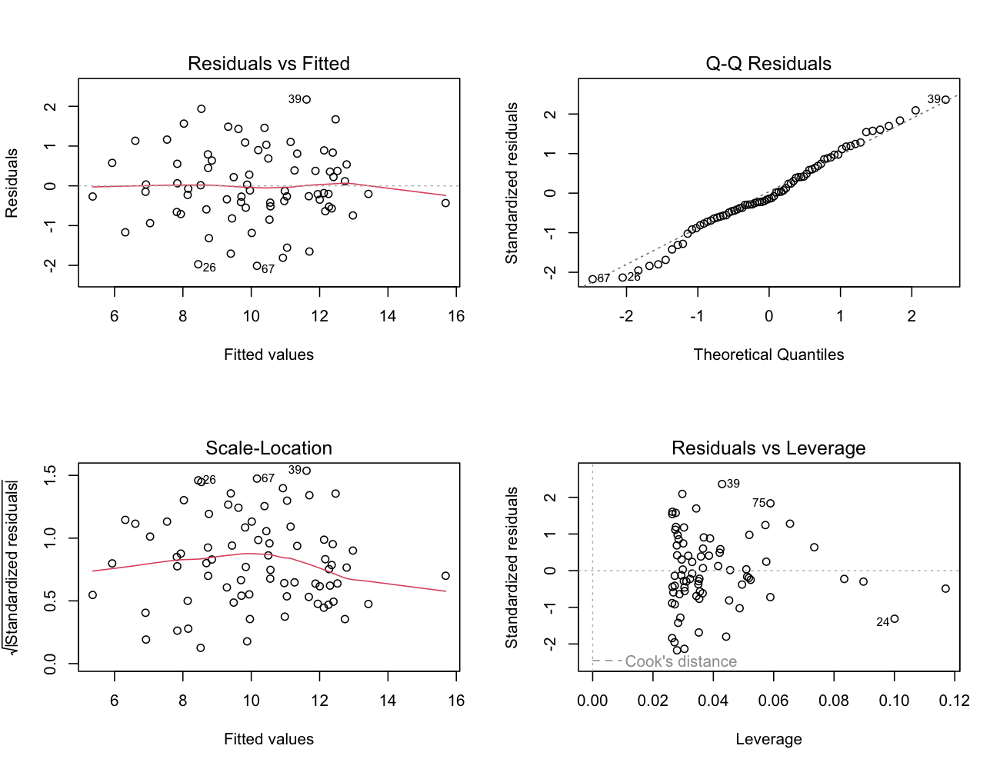

# Abstract

**Background.** Baseline adjustment is useful when comparing a continuous health outcome between two groups measured before and after an intervention.

**Objective.** Estimate the adjusted difference in follow-up HbA1c between groups A and B, conditional on baseline HbA1c.

**Methods.** A two-group educational dataset was analysed using analysis of covariance (ANCOVA), residual diagnostics, a common-slope check, heteroskedasticity-robust HC3 standard errors, and exploratory analyses of individual change.

**Data provenance.** This is an independent reanalysis of a university coursework dataset. The dataset itself does not include a study protocol, treatment descriptions, laboratory units or documentation allowing independent verification of random allocation. Findings should **not** be treated as clinical trial evidence or generalised to patients outside this dataset.

# Data and reproducibility

The supplied `data/hb.csv` uses semicolons as field separators **and commas as decimal marks**. Correct numeric import is essential: an earlier coursework draft interpreted the decimal commas incorrectly and therefore produced invalid numerical results. The present report recalculates every statistic from the corrected file.

```{r}
source("R/analysis.R", local = TRUE)
```

The dataset contains `r nrow(hb)` observations, `r length(unique(hb$id))` unique IDs and no missing values. There are `r sum(hb$groupe == "A")` observations in group A and `r sum(hb$groupe == "B")` in group B. The teaching exercise describes HbA1c at baseline (`hb0`) and at approximately three months (`hb1`). The CSV alone does not independently document the measurement units; all values are discussed in **reported units**.

# Statistical methods

The prespecified primary analytic model for this portfolio exercise was:


$$
\mathrm{HbA1c}_{1,i} =
\beta_0 +
\beta_1 I(G_i = B) +
\beta_2 \mathrm{HbA1c}_{0,i} +
\varepsilon_i
$$


The coefficient $$(\beta_1\)$$ estimates the baseline-adjusted mean difference between group B and group A. We report 95% confidence intervals and two-sided p-values. Residual plots and a Shapiro–Wilk test assess residual distribution; a Fligner–Killeen test provides an exploratory check of residual dispersion across groups. A group-by-baseline interaction is fitted to assess the common-slope assumption. HC3 robust standard errors are used as a sensitivity check. Unadjusted tests of change scores (Welch and Wilcoxon rank-sum) are exploratory and do not replace the ANCOVA estimand.

# Results

## Descriptive statistics

```{r}
knitr::kable(descriptives, digits = 2,
             caption = "Baseline, follow-up and individual change by group")
```

```{r}

```

```{r}

```

## Primary ANCOVA

```{r}
knitr::kable(coefficient_table, digits = 4,
             caption = "OLS ANCOVA coefficients and 95% confidence intervals")
```

The adjusted group-B versus group-A coefficient is **`r sprintf("%.2f", coef(ancova)["groupeB"])`** reported units (95% CI **[`r sprintf("%.2f", ancova_ci["groupeB",1])`, `r sprintf("%.2f", ancova_ci["groupeB",2])`]**, p = **`r format.pval(coef_matrix["groupeB", "Pr(>|t|)"], digits = 3, eps = 0.001)`**). The fitted model has an R-squared of `r sprintf("%.3f", ancova_summary$r.squared)`.

A negative coefficient indicates lower mean follow-up HbA1c in group B **after statistical adjustment** for baseline HbA1c. It is not, by itself, proof of a causal treatment effect.

## Diagnostics and sensitivity analyses

```{r}

```

```{r}
knitr::kable(checks, caption = "Data and diagnostic checks")
```

```{r}
knitr::kable(hc3_table, digits = 4,
             caption = "HC3 heteroskedasticity-robust ANCOVA sensitivity")
```

The group-by-baseline interaction test gives p = `r sprintf("%.3f", interaction_p)`. The residual Shapiro–Wilk test gives p = `r sprintf("%.3f", normality_residuals$p.value)`. These checks should be considered together with the plots, rather than as automatic pass/fail rules. The HC3 interval provides an additional check when residual variance may be unequal.

The exploratory change-score tests give p = `r format.pval(welch_change$p.value, digits=3, eps=0.001)` (Welch) and p = `r format.pval(wilcoxon_change$p.value, digits=3, eps=0.001)` (Wilcoxon rank-sum). These tests address unadjusted group differences in change scores and should not be interpreted as identical to the baseline-adjusted model.

# Discussion

Correct handling of decimal commas materially changes the inferred relationship between group assignment and follow-up HbA1c compared with the initial coursework draft. The reanalysed dataset supports a negative baseline-adjusted association for group B relative to group A. The ANCOVA is appropriate for the specified comparison provided the linear model assumptions and study design are adequately supported.

## Limitations

- This is a **university teaching dataset** of 75 observations, not a validated clinical study dataset.
- The raw CSV does not contain treatment descriptions, participant characteristics, allocation procedures, follow-up completeness or source documentation.
- The assignment describes a randomized parallel-group exercise, but randomization is not independently verifiable from the dataset.
- HbA1c measurement units are not separately documented in the supplied file; numerical differences are reported in the data's original units.
- Observationally, group differences cannot be assumed causal without reliable design and allocation information.
- A model-based confidence interval describes uncertainty under statistical assumptions; it does not compensate for unknown data provenance or unmeasured confounding.

# Conclusion

This project demonstrates reproducible data import, a baseline-adjusted linear model, confidence intervals, diagnostic checks, robust standard-error sensitivity and scientific interpretation using R and Quarto. The main methodological lesson is that **data import conventions must be validated before statistical modelling**.

# Reproducibility information

```{r}
print(sessionInfo())
```
